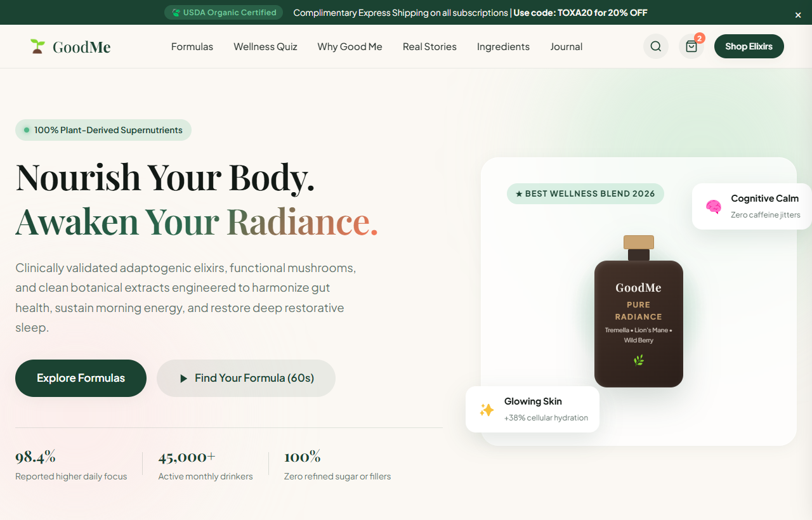

# Good Me (Toxa) — 100% Organik Salomatlik, Adaptogenlar & Superfood Eliksirlari

Good Me — inson salomatligi, ichki go'zallik, metabolizm va ong ravshanligini oshirishga mo'ljallangan tabiiy adaptogen eliksirlar hamda organik superfoodlar platformasining zamonaviy va mukammal veb-interfeysi (UI).

---

## 📸 Veb-Sahifa Ko'rinishi (Skrinshot)

---

## 🌟 Asosiy Imkoniyatlar va Funksiyalar

1. **Tabiiy Botanika Estetikasi & Dizayn Tizimi**:
   - Zangori o'rmon yashili (`#1b4332`), suli suti qaymoq rangi (`#fbf8f3`) va marjon shaftoli aksenti bilan ishlangan hashamatli ranglar gammasi.
   - `Playfair Display` va `Plus Jakarta Sans` premium shriftlari orqali tahririyat darajasidagi qulay o'qiluvchanlik.
   - Glassmorphism (shaffof xira fon) va silliq mikro-animatsiyalar.

2. **Interaktiv Salomatlik Testi (Daily Routine Quiz Finder)**:
   - Foydalanuvchi maqsadi (Energiya, Ichaklar salomatligi, Teri yorqinligi, Chuqur uyqu) va qabul qilish vaqtiga qarab algoritmlangan individual formula tavsiyasi.
   - 20% lik chegirma vaucheri bilan bir zumda savatchaga qo'shish imkoniyati.

3. **Interaktiv Yon Savatcha (Slide-out Cart Drawer)**:
   - Jonli miqdorni o'zgartirish (quantity steppers) va mahsulotni o'chirish.
   - Har bir amal bo'yicha oraliq jami (Subtotal) summani avtomatik lahzada qayta hisoblash.
   - Chiroyli Toast bildirishnomalari.

4. **Kategoriya Bo'yicha Filtrlash (Filter Tabs)**:
   - Barcha eliksirlar, Fokus & Energiya, Teri go'zalligi, Uyqu va Oshqozon-ichak tozalash bo'yicha lahzalik saralash.

5. **Ilmiy Taqqoslash Jadvali (Science & Comparison)**:
   - Sintetik arzon qo'shimchalar va Good Me ning 100% qo'shaloq ekstraksiya texnologiyasi o'rtasidagi farqlar tahlili.

---

## 🛠 Texnologiyalar Steki

- **HTML5**: Semantik teglardan tuzilgan SEO-optimallashgan struktura.
- **CSS3 (Vanilla)**: Moslashuvchan Flexbox, CSS Grid, maxsus o'zgaruvchilar (CSS Custom Properties).
- **JavaScript (ES6+)**: Reaktiv savatcha, test mantiqi, toastlar va toifalar filtrlari.
- **Shriftlar**: Google Fonts (Playfair Display, Plus Jakarta Sans).

---

## 🔗 Havolalar

- **GitHub Repositoriyasi**: [https://github.com/qodirovtoirbektts-jpg/toxa-good-me](https://github.com/qodirovtoirbektts-jpg/toxa-good-me)
- **Jonli Veb-Sahifa (Live Demo)**: [https://qodirovtoirbektts-jpg.github.io/toxa-good-me/](https://qodirovtoirbektts-jpg.github.io/toxa-good-me/)

---

### 👨‍💻 Muallif
**Toxa (qodirovtoirbektts-jpg)**
